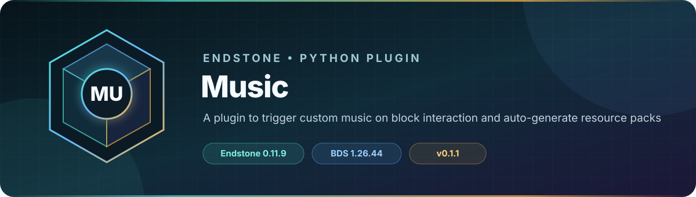

<!-- endstone-professional-header:start -->
<p align="center">
  
</p>

<p align="center">
  <a href="https://github.com/TheNINJALLO/endstone-music/actions/workflows/wheel-release.yml"></a>
  <a href="https://github.com/TheNINJALLO/endstone-music/releases/latest"></a>
</p>

<p align="center">
  
  
  
  =3.10" src="https://img.shields.io/badge/Python-%3E=3.10-3776AB?style=flat-square&amp;logo=python&amp;logoColor=white">
</p>

<p align="center">
  <strong>A plugin to trigger custom music on block interaction and auto-generate resource packs.</strong>
</p>

<p align="center">
  <a href="#what-it-does">What it does</a> &bull;
  <a href="#how-to-use">How to use</a> &bull;
  <a href="#commands-and-permissions">Commands</a> &bull;
  <a href="#install">Install</a> &bull;
  <a href="https://github.com/TheNINJALLO/endstone-music/releases">Releases</a>
</p>

## Overview

A plugin to trigger custom music on block interaction and auto-generate resource packs. This release is aligned with Endstone 0.11.9 and Minecraft Bedrock Dedicated Server 1.26.44, and is distributed as a Python wheel for direct installation in an Endstone server.

## What it does

- Plays custom music when configured item, block, or item-and-block interactions occur.
- Builds a Bedrock resource pack from uploaded OGG, MP3, or WAV audio.
- Provides form-based trigger creation, trigger management, distance, volume, pitch, broadcast, and message settings.

## How to use

1. Place audio files in the plugin's `uploads/` directory, then run `/cmusic generate`.
2. Restart the server so clients receive the generated resource pack.
3. Run `/cmusic`, create a trigger, and select its item/block conditions and sound settings.
4. Use `/cmusic reload` after supported manual configuration edits.

## Commands and permissions

| Command / usage | What it does | Access |
|---|---|---|
| `/cmusic`<br>`/cmusic <reload\|generate\|migrate>` | Manage custom music triggers and resource packs | `endstone_music.command.cmusic` |

## Compatibility

| Component | Supported version |
|---|---|
| Endstone | `0.11.9` |
| Endstone API | `0.11` |
| Bedrock Dedicated Server | `1.26.44` |
| Python | `>=3.10` |
| Plugin release | `v0.1.2` |

## Install

Download the wheel from the matching GitHub release:

```bash
gh release download v0.1.2 --repo TheNINJALLO/endstone-music --pattern "*.whl"
```

Copy the downloaded wheel into the server's `plugins/` directory, remove any older wheel for the same plugin, and restart Endstone.

> [!IMPORTANT]
> Use Endstone `0.11.9` with BDS `1.26.44`. Back up worlds and plugin data before upgrading a production server.

## Configuration and secrets

Runtime databases, logs, local `.env` files, server directories, and root `config.toml` files are excluded from source releases. When an example configuration is provided, copy it locally and keep live tokens, passwords, webhook URLs, and server identifiers out of Git.

## Release automation

Every `v*` tag runs [the wheel release workflow](.github/workflows/wheel-release.yml), builds the package in a clean GitHub runner, stores the wheel as a workflow artifact, and attaches it to the matching GitHub release.
<!-- endstone-professional-header:end -->

---

## Project guide

A powerful custom music plugin for Endstone Bedrock servers that allows operators to trigger custom sounds when players interact with blocks or items.

## Features

- **Custom Sound Triggers**: Three trigger modes:
  - **Item + Block**: Sound when specific item is used on specific block
  - **Item Only**: Sound when clicking anywhere with specific item (follows player)
  - **Block Only**: Sound when clicking specific block with any item
- **Automated Resource Pack Generation**: 
  - Drop `.ogg`, `.mp3`, or `.wav` files into the `uploads` folder
  - Automatic conversion to Bedrock-compatible format (Stereo, 44.1kHz)
  - Auto-installs to your world's resource_packs folder
  - Version auto-bumps on each generation
- **In-Game Configuration UI**: Add, view, and delete triggers via forms
- **Distance-Based Audio**: Configure audible range (100 - 1,000,000 blocks)
- **Broadcast Mode**: Play sounds to all nearby players
- **Stops Overlapping Sounds**: New triggers automatically stop previous sounds

## Installation

1. Build or download the plugin wheel
2. Place in your Endstone `plugins` folder
3. Start the server

## Commands

| Command | Description |
|---------|-------------|
| `/cmusic` | Open the in-game configuration menu |
| `/cmusic generate` | Generate resource pack from uploaded audio |
| `/cmusic reload` | Reload config without restart |

## Usage

### Adding Custom Sounds

1. **Upload audio** to `plugins/endstone_music/uploads/`
   - Supports: `.ogg`, `.mp3`, `.wav`
   - MP3/WAV auto-convert and delete after conversion

2. **Generate pack**: `/cmusic generate`

3. **Restart server** to apply the resource pack

### Adding Triggers (In-Game)

1. Run `/cmusic` → **Add New Trigger**
2. Configure:
   - **Trigger Mode**: Item+Block, Item Only, or Block Only
   - **Item/Block**: Minecraft IDs
   - **Sound**: Select from dropdown
   - **Volume/Pitch**: Adjust playback
   - **Distance**: Audible range (100 - 1,000,000 blocks)
   - **Broadcast**: Play to all nearby players
   - **Loop**: Loop the sound (saved for future use)
   - **Message**: Optional chat message

### Managing Triggers

1. Run `/cmusic` → **Manage Triggers**
2. Select a trigger to view details
3. Delete triggers you no longer need

## Configuration

Edit `plugins/endstone_music/config.json`:

```json
{
  "pack_name": "My Server Music",
  "target_world_name": "Bedrock level",
  "triggers": [
    {
      "mode": "block_only",
      "item": "minecraft:stick",
      "block": "minecraft:jukebox",
      "sound": "custom.mysong",
      "volume": 1.0,
      "pitch": 1.0,
      "distance": 1000,
      "broadcast": true,
      "loop": false,
      "message": "§aNow playing: My Song"
    }
  ]
}
```

## Sound Naming

- `mysong.ogg` → `custom.mysong`
- `epic_battle.mp3` → `custom.epic_battle`

## Dependencies

- **pydub**: Audio processing
- **static-ffmpeg**: Bundled FFmpeg (no system install needed)

## Troubleshooting

| Issue | Solution |
|-------|----------|
| Pack not loading | Check `target_world_name` matches your world folder |
| No sound in-game | Ensure clients downloaded the pack |
| Triggers not working | Run `/cmusic reload` |
